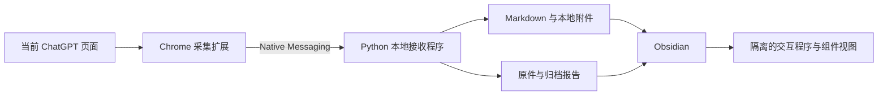

# 架构与范围

## 目录

| 目录/文件 | 作用 |
| --- | --- |
| `extension/` | 弹窗、页面采集、代码文档读取、资源打包和本地 DIL 兼容运行时 |
| `host/` | Native Messaging、输入与附件校验、磁盘写入、Markdown 转换、临时离线验证浏览器 |
| `plugin-src/main.js` | Obsidian 插件入口源码 |
| `shared/` | 归档播放器、原位组件桥接、页面快照绑定及离线公式依赖 |
| `obsidian-plugin/` | 可安装插件产物；`main.js` 由构建脚本生成 |
| `install.py` / `update.py` | 安装入口、库选择、备份、当前用户通信注册 |
| `convert_native.py` | 旧整篇播放器笔记的预览和显式转换 |
| `tests/` | 人工合成数据上的回归检查 |

## 数据边界

采集器针对当前页面当前分支的已加载消息。它可能滚动加载早期消息并检查消息身份的稳定性，但不能证明服务器端完整历史总数。编辑器读取只针对页面上有明确关联的实例，不枚举未关联的编辑器模型，不调用会话历史 API。

完整归档容器使用 schema 2，包含有身份标识的消息、页面快照、原程序与资源清单。附件由 SHA-256 关联，资源名称受白名单限制。正文采用原生 Markdown；完整程序在隔离框架中运行，原位组件共享一份程序状态。已有 schema 1 的 `chatgpt-html` 和 `chatgpt-layout` 保留读取兼容。

主机按受限文件名接收附件，将目标路径解析到指定库内，发布笔记前保存并核对资源。内容指纹用于区分快照；重新导入会校验既有快照。可读笔记与快照不一致时生成独立副本，保留用户修改。

## 权限与运行

扩展的公开 manifest key 固定 ID，从而匹配 Native Messaging `allowed_origins`。Windows 安装器只登记 `HKEY_CURRENT_USER` 下本项目的原生主机键，不修改系统范围配置。运行时文件在本地生成，仓库不携带用户路径。

普通采集会下载页面引用的图片或依赖；这和离线回放是两个阶段。支持的原生交互视图通过受限消息桥交换表单动作和状态，原程序不会直接进入 Obsidian 主窗口执行。旧版 HTML 回放的兼容范围与新组件不同，不应把任意来源代码视为可信。

本项目不是通用浏览器沙箱或完整网页仿真器。兼容运行时不拥有 ChatGPT 在线服务，不能离线生成新的模型回答。需要继续提问的组件只产生可复制的请求文字。

## 验证含义

- 代码完整性检查证明采集到的文档与可读取模型的行数相符；无法确定时停止写入。
- 文件校验证明所保存正文和附件与本次记录一致。
- 回归测试覆盖合成场景，不能代替每次 ChatGPT 页面更新后的实际对话验收。
- UI 外观、交互支持程度、未加载历史和不可访问资源均有独立限制，报告不会将它们等同于文件校验成功。
