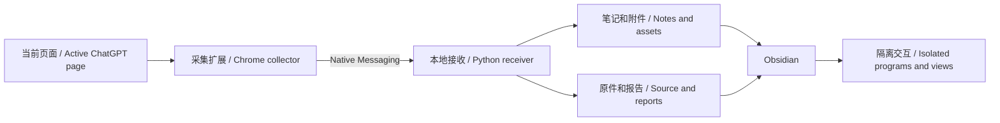

# 架构与范围 / Architecture and scope

[README](../README.md) · [安装 / Installation](INSTALL.md)

## 目录 / Repository layout

| 中文 | English |
| --- | --- |
| `extension/`：弹窗、页面采集、完整代码读取、资源打包和本地 DIL 兼容运行时。 | `extension/`: popup, page capture, full editor-document reads, resource packing and the local DIL compatibility runtime. |
| `host/`：本机通信、输入和附件校验、磁盘写入、Markdown 转换及临时离线验证浏览器。 | `host/`: Native Messaging, input and asset validation, disk writes, Markdown conversion and a temporary offline validation browser. |
| `plugin-src/main.js`：Obsidian 插件入口源码。 | `plugin-src/main.js`: source for the Obsidian plugin entry point. |
| `shared/`：播放器、原位组件桥接、快照绑定及离线公式依赖。 | `shared/`: player, inline component bridge, snapshot bindings and offline math dependencies. |
| `obsidian-plugin/`：可安装产物；`main.js` 由构建脚本生成。 | `obsidian-plugin/`: installable artifacts; `main.js` is generated by the build script. |
| `install.py` / `update.py`：安装、库选择、备份及当前用户通信注册。 | `install.py` / `update.py`: installation, vault selection, backups and native host registration for the current user. |
| `convert_native.py`：旧整篇播放器笔记的预览和显式转换。 | `convert_native.py`: preview and explicit conversion of older whole-note player exports. |
| `tests/`：合成数据上的回归检查。 | `tests/`: regression checks using synthetic data. |

## 数据边界 / Data boundaries

| 中文 | English |
| --- | --- |
| 采集当前分支的已加载消息；滚动和身份稳定性检查不能证明服务器端完整历史总数。 | Capture targets loaded messages in the current branch. Scrolling and identity-stability checks do not establish the total server-side history. |
| 编辑器读取限于与当前页面明确关联的实例；不枚举无关模型，不调用会话历史 API。 | Editor reads are limited to instances explicitly associated with the current page. The collector does not enumerate unrelated models or call conversation-history APIs. |
| schema 2 容器包含有身份的消息、页面快照、原程序和资源清单；附件以 SHA-256 关联，资源名有白名单。 | Schema 2 containers include identified messages, page snapshots, source programs and resource manifests. Assets are linked by SHA-256 and their names are allowlisted. |
| 正文为原生 Markdown；原程序在隔离框架中运行，同一程序的多个组件视图共享状态。保留旧 schema 1 的 `chatgpt-html` 与 `chatgpt-layout` 读取兼容。 | Prose remains native Markdown. Source programs run in isolated frames and views of the same program share state. Reading compatibility is retained for older schema 1 `chatgpt-html` and `chatgpt-layout` blocks. |
| 主机将目标路径解析到指定库内，并在发布笔记前保存和核对资源。内容指纹区分快照，重导入时校验已有快照。 | The receiver resolves destinations within the selected vault and saves and checks resources before publishing the note. Content fingerprints identify snapshots, and existing snapshots are verified during re-import. |
| 可读笔记与快照不一致时生成独立副本，保留用户修改。 | If a readable note differs from its snapshot, a separate copy is created to preserve user edits. |

## 权限与运行 / Permissions and execution

| 中文 | English |
| --- | --- |
| 公开 manifest key 固定扩展 ID，以匹配 Native Messaging 的 `allowed_origins`。 | The public manifest key fixes the extension ID so it matches Native Messaging `allowed_origins`. |
| Windows 安装只登记 `HKEY_CURRENT_USER` 下本项目的主机项；运行配置在本地生成。 | Windows installation registers only this project’s host key under `HKEY_CURRENT_USER`. Runtime configuration is generated locally. |
| 采集会下载页面引用资源；离线回放是独立阶段。 | Capture downloads resources referenced by the page; offline replay is a separate stage. |
| 受支持的原生组件通过受限消息桥交换表单动作和状态；原程序不会在 Obsidian 主窗口直接执行。 | Supported native components exchange form actions and state through a restricted message bridge. Source programs do not execute directly in the main Obsidian window. |
| 旧 HTML 回放与新组件的兼容边界不同；本项目不是通用浏览器沙箱，不能把任意来源代码视作可信。 | Legacy HTML replay and new components have different compatibility boundaries. This project is not a general-purpose browser sandbox; arbitrary source code must not be assumed trustworthy. |
| 本地兼容运行时不提供 ChatGPT 在线服务；继续提问的组件只生成可复制的请求文字。 | The local compatibility runtime does not provide ChatGPT’s online services. Components that continue a conversation only generate request text to copy back to ChatGPT. |

## 验证含义 / What verification establishes

| 中文 | English |
| --- | --- |
| 代码检查核对采集文档与可读取模型的行数，无法确认时停止写入。 | Code checks compare captured document line counts with readable editor models and stop writes when completeness cannot be established. |
| 文件校验核对保存正文、附件与本次记录的一致性。 | File verification checks that saved prose and attachments match this capture’s records. |
| 合成回归测试不能替代页面更新后的真实对话验收。 | Synthetic regression tests do not replace validation on real conversations after page updates. |
| 外观、交互、未加载历史和不可访问资源具有各自的限制，报告会单独说明。 | Appearance, interactive support, unloaded history and inaccessible resources have separate limitations, which reports describe independently. |
