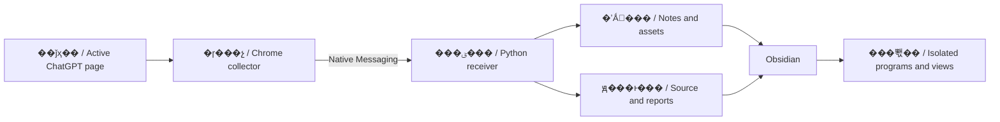

# �ܹ��뷶Χ / Architecture and scope

[README](../README.md) �� [��װ / Installation](INSTALL.md)

## Ŀ¼ / Repository layout

| ���� | English |
| --- | --- |
| `extension/`��������ҳ��ɼ������������ȡ����Դ����ͱ��� DIL ��������ʱ�� | `extension/`: popup, page capture, full editor-document reads, resource packing and the local DIL compatibility runtime. |
| `host/`������ͨ�š�����͸���У�顢����д�롢Markdown ת������ʱ������֤������� | `host/`: Native Messaging, input and asset validation, disk writes, Markdown conversion and a temporary offline validation browser. |
| `plugin-src/main.js`��Obsidian ������Դ�롣 | `plugin-src/main.js`: source for the Obsidian plugin entry point. |
| `shared/`����������ԭλ����Žӡ����հ󶨼����߹�ʽ������ | `shared/`: player, inline component bridge, snapshot bindings and offline math dependencies. |
| `obsidian-plugin/`���ɰ�װ���`main.js` �ɹ����ű����ɡ� | `obsidian-plugin/`: installable artifacts; `main.js` is generated by the build script. |
| `install.py` / `update.py`����װ����ѡ�񡢱��ݼ���ǰ�û�ͨ��ע�ᡣ | `install.py` / `update.py`: installation, vault selection, backups and native host registration for the current user. |
| `convert_native.py`������ƪ�������ʼǵ�Ԥ������ʽת���� | `convert_native.py`: preview and explicit conversion of older whole-note player exports. |
| `tests/`���ϳ������ϵĻع��顣 | `tests/`: regression checks using synthetic data. |

## ���ݱ߽� / Data boundaries

| ���� | English |
| --- | --- |
| �ɼ���ǰ��֧���Ѽ�����Ϣ�������������ȶ��Լ�鲻��֤����������������ʷ������ | Capture targets loaded messages in the current branch. Scrolling and identity-stability checks do not establish the total server-side history. |
| �༭����ȡ�����뵱ǰҳ����ȷ������ʵ������ö���޹�ģ�ͣ������ûỰ��ʷ API�� | Editor reads are limited to instances explicitly associated with the current page. The collector does not enumerate unrelated models or call conversation-history APIs. |
| schema 2 �������������ݵ���Ϣ��ҳ����ա�ԭ�������Դ�嵥�������� SHA-256 ��������Դ���а������� | Schema 2 containers include identified messages, page snapshots, source programs and resource manifests. Assets are linked by SHA-256 and their names are allowlisted. |
| ����Ϊԭ�� Markdown��ԭ�����ڸ����������У�ͬһ����Ķ�������ͼ����״̬�������� schema 1 �� `chatgpt-html` �� `chatgpt-layout` ��ȡ���ݡ� | Prose remains native Markdown. Source programs run in isolated frames and views of the same program share state. Reading compatibility is retained for older schema 1 `chatgpt-html` and `chatgpt-layout` blocks. |
| ������Ŀ��·��������ָ�����ڣ����ڷ����ʼ�ǰ����ͺ˶���Դ������ָ�����ֿ��գ��ص���ʱУ�����п��ա� | The receiver resolves destinations within the selected vault and saves and checks resources before publishing the note. Content fingerprints identify snapshots, and existing snapshots are verified during re-import. |
| �ɶ��ʼ�����ղ�һ��ʱ���ɶ��������������û��޸ġ� | If a readable note differs from its snapshot, a separate copy is created to preserve user edits. |

## Ȩ�������� / Permissions and execution

| ���� | English |
| --- | --- |
| ���� manifest key �̶���չ ID����ƥ�� Native Messaging �� `allowed_origins`�� | The public manifest key fixes the extension ID so it matches Native Messaging `allowed_origins`. |
| Windows ��װֻ�Ǽ� `HKEY_CURRENT_USER` �±���Ŀ����������������ڱ������ɡ� | Windows installation registers only this project��s host key under `HKEY_CURRENT_USER`. Runtime configuration is generated locally. |
| �ɼ�������ҳ��������Դ�����߻ط��Ƕ����׶Ρ� | Capture downloads resources referenced by the page; offline replay is a separate stage. |
| ��֧�ֵ�ԭ�����ͨ��������Ϣ�Ž�������������״̬��ԭ���򲻻��� Obsidian ������ֱ��ִ�С� | Supported native components exchange form actions and state through a restricted message bridge. Source programs do not execute directly in the main Obsidian window. |
| �� HTML �ط���������ļ��ݱ߽粻ͬ������Ŀ����ͨ�������ɳ�䣬���ܰ�������Դ�����������š� | Legacy HTML replay and new components have different compatibility boundaries. This project is not a general-purpose browser sandbox; arbitrary source code must not be assumed trustworthy. |
| ���ؼ�������ʱ���ṩ ChatGPT ���߷��񣻼������ʵ����ֻ���ɿɸ��Ƶ��������֡� | The local compatibility runtime does not provide ChatGPT��s online services. Components that continue a conversation only generate request text to copy back to ChatGPT. |

## ��֤���� / What verification establishes

| ���� | English |
| --- | --- |
| ������˶Բɼ��ĵ���ɶ�ȡģ�͵��������޷�ȷ��ʱֹͣд�롣 | Code checks compare captured document line counts with readable editor models and stop writes when completeness cannot be established. |
| �ļ�У��˶Ա������ġ������뱾�μ�¼��һ���ԡ� | File verification checks that saved prose and attachments match this capture��s records. |
| �ϳɻع���Բ������ҳ����º����ʵ�Ի����ա� | Synthetic regression tests do not replace validation on real conversations after page updates. |
| ��ۡ�������δ������ʷ�Ͳ��ɷ�����Դ���и��Ե����ƣ�����ᵥ��˵���� | Appearance, interactive support, unloaded history and inaccessible resources have separate limitations, which reports describe independently. |
